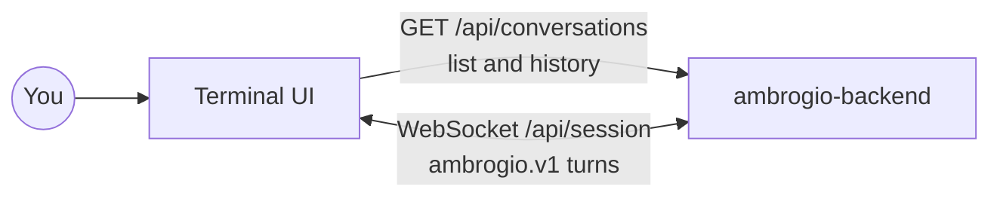

<p align="center">
  <picture>
    <source media="(prefers-color-scheme: dark)" srcset=".github/logo-dark.svg">
    
  </picture>
</p>

# Ambrogio — terminal client

**Ambrogio** is an open source home assistant that you host yourself. This repository is its **terminal chat client**: a full-screen text interface for talking to an Ambrogio backend from any terminal.

| Repository | Role |
|---|---|
| [ambrogio-backend](https://github.com/ambrogio-app/ambrogio-backend) | Conversation server, agents, speech, storage, public protocol |
| **ambrogio-cli** (this one) | Terminal chat client |
| [ambrogio-satellite](https://github.com/ambrogio-app/ambrogio-satellite) | Voice satellite with wake word, microphone and speaker |

> Ambrogio is in early development and currently speaks Italian.

## How it works

```
┌─ Chats ───────────────┐┌─ Conversation ───────────────────────────┐
│ ▸ New chat            ││ you: what's on the shopping list?        │
│   Shopping list       ││ ambrogio: milk, eggs and bread…          │
│   Weekend plans       ││                                          │
│   …                   ││──────────────────────────────────────────│
│                       ││ > _                                      │
└───────────────────────┘└──────────────────────────────────────────┘
```

On the left you see your conversations; on the right, the open conversation and an input field. The backend stores every conversation, so a chat you start here can go on from a voice satellite, and the other way round.



- **Conversation list and history** come from the backend's HTTP API and load page by page.
- **Messages** travel over a WebSocket session that uses the `ambrogio.v1` protocol. The CLI opens the session when you send your first message. Answers stream in as the backend produces them.
- The client identifies itself to the backend as `cli-<hostname>` unless you set another ID.

## Dependencies

- Node.js 22 or later, with npm
- An interactive terminal of at least 70 × 14 characters
- A running [ambrogio-backend](https://github.com/ambrogio-app/ambrogio-backend) that this machine can reach
- Runtime library: [Terminal Kit](https://github.com/cronvel/terminal-kit). The client uses Node's built-in `WebSocket` and `fetch`

The backend version this client is compatible with is recorded in [`system-model/Contracts/TerminalConversation.md`](system-model/Contracts/TerminalConversation.md).

## Quick start

```bash
npm ci
npm run build
npm start -- --server http://my-ambrogio:3000
```

You can also set the server with `AMBROGIO_URL`, and the client ID with `--client-id` or `AMBROGIO_CLIENT_ID`. There is no default server URL.

| Key | Action |
|---|---|
| `Enter` | Send the message, or open the selected chat |
| `Tab` | Switch between the input field and the chat list |
| `Ctrl+N` | New chat |
| `Ctrl+R` | Refresh the list and the current chat |
| `Ctrl+L` | Load more chats |
| `Ctrl+Q` | Quit |

## Development

```bash
npm test               # protocol and UI tests against a local fake backend
npm run test:backend   # end-to-end test against a pinned ambrogio-backend checkout
```

`npm run test:backend` expects a built checkout of `ambrogio-backend` at `../ambrogio-backend`, or at the path in `AMBROGIO_BACKEND_REPO`.

[gitleaks](https://github.com/gitleaks/gitleaks) 8.30.1 checks for secrets. CI scans the whole history on every push and pull request (`.github/workflows/secret-scan.yml`). Locally, enable the versioned pre-commit hook once per clone; it needs `gitleaks` on `PATH` and blocks commits that add a secret:

```bash
git config core.hooksPath .githooks
```

Ambrogio is developed model first with [Reqvire](https://reqvire.org/). This repository is self-contained: the repository root is its Reqvire workspace, and [`system-model/`](system-model/) records the client's own requirements, contracts, verifications and technical decisions. The backend's public protocol and HTTP API belong to `ambrogio-backend`. [`AGENTS.md`](AGENTS.md) describes the workflow.

## License

[MIT](LICENSE)
